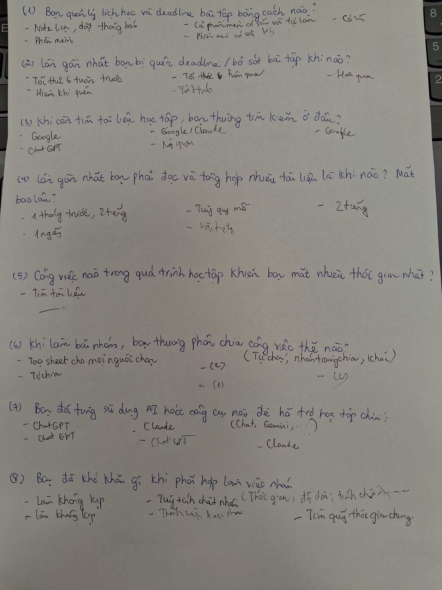

# Báo cáo nhóm — Day 02 Discovery & Problem Framing

> Bản chung của nhóm, viết trên repo do nhóm trưởng fork. Không copy file này sang repo cá nhân.
> Template chi tiết và prompt mẫu: [docs/01-worksheet.md](../../docs/01-worksheet.md). Bài mẫu: [docs/02-deliverable-example.md](../../docs/02-deliverable-example.md).

## 1. Thông tin nhóm

- Tên nhóm: NhomMTGD
- Thành viên: xem `TEAM.md` (Đinh Lê Thịnh, Nguyễn Xuân Dương, Trần Thị Hồng Gấm, Trần Duy Mạnh)
- Candidate problem được chọn (1 câu): Hỗ trợ sinh viên chuyển thông báo học tập không có cấu trúc từ LMS, Zalo, Discord thành nhiệm vụ có cấu trúc và deadline theo dõi được trên lịch cá nhân.
- Quyết định cuối: Go (Phạm vi nhỏ — Workflow kết hợp AI trích xuất + Rule validation + Sinh viên xác nhận HITL)

---

## 2. Hội tụ nhóm (CP3)

### 2.1. Pitch

Nhóm gồm 4 thành viên, tổng hợp đủ 12 candidate từ các Problem Card cá nhân (CP2):

| # | Người đưa ra | Candidate (Job Story ngắn) | Actor | Bottleneck | Câu hỏi phản biện nhận được (ai hỏi) |
|---:|---|---|---|---|---|
| 1 | Nguyễn Xuân Dương | Khi có nhiều deadline từ các môn học khác nhau, tôi muốn tổng hợp tất cả vào một nơi để không bỏ sót bài tập. | Sinh viên đại học | Mở nhiều nhóm Zalo, Discord và Google Classroom để tìm hạn nộp (~30 phút/tuần) | Các công cụ như Google Calendar hay Notion đã có sẵn, tại sao sinh viên vẫn bị quên deadline? (Mạnh hỏi) |
| 2 | Nguyễn Xuân Dương | Khi cần tìm lại tài liệu học tập, tôi muốn nhanh chóng xác định đúng file trong Drive hoặc nhóm chat để không mất thời gian tìm kiếm. | Sinh viên | Tìm kiếm file bị trôi trong tin nhắn chat nhóm (~20 phút/lần) | Vấn đề là do công cụ tìm kiếm kém hay do thói quen đặt tên file bừa bãi? (Thịnh hỏi) |
| 3 | Nguyễn Xuân Dương | Khi chuẩn bị báo cáo tiến độ nghiên cứu, tôi muốn tổng hợp kết quả công việc và tài liệu đã đọc để báo cáo cho giảng viên hướng dẫn. | Sinh viên nghiên cứu | Đọc lại ghi chú và tổng hợp các file rời rạc (~2 tiếng/tuần) | Báo cáo tiến độ này có form mẫu cố định chưa, hay mỗi tuần một kiểu? (Gấm hỏi) |
| 4 | Trần Thị Hồng Gấm | Khi nhận thông báo và nhiệm vụ học tập từ LMS, Discord, Zalo, tôi muốn xác định đầy đủ công việc và thời hạn để quản lý tiến độ, tránh bỏ sót deadline. | Sinh viên năm cuối | Đọc và nhận diện nhiệm vụ từ văn bản tự do, nhập thủ công vào lịch (~30 phút/tuần) | Làm sao AI phân biệt được deadline bài tập bắt buộc với lời nhắc thảo luận thông thường? (Dương hỏi) |
| 5 | Trần Thị Hồng Gấm | Khi bắt đầu nghiên cứu một chủ đề AI mới, tôi muốn tìm kiếm, đọc hiểu và so sánh các bài báo để xác định hướng nghiên cứu phù hợp. | Sinh viên ngành AI | Đọc lướt 5–7 paper và tổng hợp ma trận so sánh (~4 tiếng/tuần) | Bài toán này quá rộng, làm sao đánh giá được AI tóm tắt đúng hay bịa đặt (hallucination)? (Mạnh hỏi) |
| 6 | Trần Thị Hồng Gấm | Khi thực hiện bài tập nhóm, tôi muốn nắm được tiến độ và khó khăn của từng thành viên để phối hợp hiệu quả và hoàn thành đúng hạn. | Nhóm trưởng | Nhắn tin hỏi dồn từng người và đọc lại các đoạn chat (~45 phút/buổi họp) | Chậm deadline là do thiếu thông tin cập nhật hay do ý thức và năng lực thành viên? (Thịnh hỏi) |
| 7 | Đinh Lê Thịnh | Khi tham gia chương trình có nhiều kênh thông báo, tôi muốn cập nhật đầy đủ thông tin kịp thời để không bỏ sót các thông báo quan trọng. | Học viên, Staff | Đọc lướt hàng chục thông báo mỗi ngày trên Discord và LMS (~25 phút/ngày) | Sinh viên có thực sự đọc hết thông báo không hay chỉ tìm từ khóa khi cận hạn? (Gấm hỏi) |
| 8 | Đinh Lê Thịnh | Khi làm lab có nhiều tài liệu tham khảo, tôi muốn tìm nhanh yêu cầu cần hoàn thành để không tốn thời gian dò lại các tài liệu dài. | Học viên làm lab | Mở qua lại giữa file README, RUBRIC và slide (~2 phút/lần, 10 lần/lab) | Tại sao không dùng chức năng `Ctrl + F` trong file Markdown mà cần giải pháp mới? (Mạnh hỏi) |
| 9 | Đinh Lê Thịnh | Khi nhóm gần đến deadline nộp bài, tôi muốn biết thành viên nào còn gặp issue để nhóm kịp hỗ trợ và hoàn thành công việc chung. | Cả team làm bài | Hỏi và tổng hợp tình hình vướng mắc của từng người (~30 phút/tuần) | Nếu thành viên giấu không báo issue thì công cụ có giải quyết được không? (Dương hỏi) |
| 10 | Trần Duy Mạnh | Khi đợt huấn luyện mô hình dài 5–7 tiếng kết thúc, tôi muốn tổng hợp nhanh bảng đối chiếu các chỉ số (Loss, F1, Latency) và các ca phân loại sai để quyết định hướng điều chỉnh siêu tham số tiếp theo. | Người train model AI | Cuộn tìm log terminal và đối chiếu thủ công giữa các lần chạy cũ (~30 phút/lần) | Dùng TensorBoard hay Wandb đã hiển thị biểu đồ loss/metric rồi, AI can thiệp vào bước nào? (Dương hỏi) |
| 11 | Trần Duy Mạnh | Khi hoàn thành bài thực nghiệm trên lớp với nhiều mô hình, tôi muốn tổng hợp các chỉ số F1, latency p95 và chi phí vào bảng đối chiếu chuẩn để viết báo cáo kỹ thuật. | Học viên làm lab | Mở từng notebook tìm cell in kết quả và copy số liệu thủ công (~45–60 phút/lab) | Viết một script Python xuất file JSON chuẩn là xong, có cần thiết phải dùng AI không? (Thịnh hỏi) |
| 12 | Trần Duy Mạnh | Khi chuẩn bị nộp bài lab trước deadline 23h59, tôi muốn đối chiếu toàn bộ các tệp trong repo với danh mục yêu cầu trong rubric để đảm bảo không bị trừ điểm cấu trúc. | Học viên nộp bài | Mở rà soát thủ công từng dòng trong báo cáo dài (~15 phút sát giờ nộp) | Việc này dùng script linter regex kiểm tra tên file là đủ, AI có thừa không? (Gấm hỏi) |

### 2.2. Cluster

Nhóm gom 12 candidate trên thành 4 cụm dựa trên bản chất của vấn đề:

| Cluster | Các candidate | Pattern chung |
|---|---|---|
| **A — Quản lý lịch học & Trích xuất deadline phân tán** | Candidate #1, #4, #7, #12 | Thông tin nhiệm vụ nằm rải rác trên nhiều nền tảng (LMS, Zalo, Discord), viết bằng văn bản tự nhiên không có cấu trúc cố định; sinh viên phải đọc, nhận diện và nhập thủ công vào lịch. |
| **B — Tìm kiếm & Tổng hợp tài liệu học tập / nghiên cứu** | Candidate #2, #3, #5, #8 | Dữ liệu học tập và tài liệu nghiên cứu dài, nằm ở nhiều nơi; người học mất thời gian tra cứu, đọc hiểu và tổng hợp thông tin chuyên môn. |
| **C — Theo dõi tiến độ & Điều phối bài tập nhóm** | Candidate #6, #9 | Công việc phân tán trong trao đổi chat nhóm; trưởng nhóm mất thời gian hỏi dồn, nhắc nhở và cập nhật ai đã xong, ai còn vướng issue. |
| **D — Tự động hóa số liệu kỹ thuật & Huấn luyện mô hình AI** | Candidate #10, #11 | Thực nghiệm kỹ thuật sinh ra nhiều log và chỉ số số học; tốn thời gian tổng hợp thủ công từ console/notebook sang bảng đối chiếu. |

### 2.3. Opportunity Solution Tree rút gọn

```text
OUTCOME: 
Giảm thời gian tạo và theo dõi nhiệm vụ học tập từ 30 phút xuống ≤ 15 phút/tuần
mà không làm tăng nguy cơ ghi sai hoặc bỏ sót deadline.

├── Opportunity 1 (Pain phân tán):
│   Nhiệm vụ học tập và bài tập nằm rải rác trên LMS, Zalo và Discord.
│
├── Opportunity 2 (Pain cấu trúc):
│   Nhiều thông báo giao bài viết bằng văn bản tự nhiên, không có cấu trúc chuẩn,
│   khiến sinh viên phải đọc toàn bộ tin nhắn mới nhận diện được thời hạn.
│
├── Opportunity 3 (Pain thao tác thủ công):
│   Sinh viên phải tự đọc và gõ lại từng trường thông tin (tên môn, deadline, yêu cầu)
│   vào ứng dụng lịch cá nhân.
│
└── Opportunity 4 (Pain trôi thông tin):
    Thông báo dời lịch hoặc thay đổi deadline bị trôi trong luồng chat nhóm,
    không được cập nhật kịp thời vào lịch cá nhân.

Những ý đã gạch bỏ vì là SOLUTION đội lốt Opportunity:
✗ "Xây dựng chatbot AI toàn năng nhắc nhở học tập" (Solution)
✗ "AI Agent tự động đăng nhập và đọc trộm tài khoản LMS, Zalo, Discord" (Solution vi phạm bảo mật)
✗ "Tích hợp ứng dụng quản lý dự án Jira cho sinh viên" (Solution)
```

### 2.4. Chấm điểm shortlist (1–5)

Nhóm chọn ra 3 candidate đại diện cho 3 cụm nổi bật nhất để chấm điểm theo 7 tiêu chí:

| Candidate | Actor rõ | Quy trình rõ | Pain có bằng chứng | Impact đo được | Vừa sức lab | So sánh được No AI/Rule/Workflow/Agent | Nhóm hiểu domain | Tổng |
|---|---:|---:|---:|---:|---:|---:|---:|---:|
| **1. Quản lý lịch học và trích xuất deadline phân tán (Cụm A)** | 5 | 5 | 5 | 4 | 5 | 5 | 5 | **34** |
| 2. Tìm kiếm và tổng hợp tài liệu nghiên cứu (Cụm B) | 4 | 4 | 4 | 3 | 3 | 4 | 4 | **26** |
| 3. Theo dõi tiến độ và xử lý issue bài tập nhóm (Cụm C) | 4 | 4 | 4 | 3 | 4 | 3 | 4 | **26** |

**Candidate được chọn:**
Candidate #1/4 — **Hỗ trợ sinh viên chuyển thông báo học tập không có cấu trúc từ LMS, Zalo, Discord thành nhiệm vụ có cấu trúc và deadline theo dõi được trên lịch cá nhân.**

**Vì sao chọn:**
1. **Bằng chứng có thật và sát sườn:** Cả 4 thành viên nhóm và các bạn sinh viên trong lớp đều gặp phải tình trạng trôi deadline (đặc biệt là bài lab vừa qua).
2. **Quy trình và ranh giới rõ ràng:** Tách bạch tường minh giữa bước đọc hiểu ngôn ngữ tự nhiên (AI làm) và bước xác nhận lưu lịch (con người làm).
3. **Vừa sức trong phạm vi lab:** Có thể kiểm chứng bằng phỏng vấn người thật ngay trong lớp, đo đạc được thời gian tiết kiệm cụ thể và xây dựng được prototype trong thời gian ngắn.
4. **Phân cấp công nghệ rõ ràng:** So sánh được rành mạch giữa No AI (Google Tasks), Rule (Regex ngày giờ), Workflow (AI NER + Validation) và Agent.

**Vì sao loại các candidate còn lại:**
- **Loại "Tìm kiếm và tổng hợp tài liệu nghiên cứu":** Phạm vi quá rộng, chất lượng tóm tắt tài liệu khoa học mang tính chủ quan cao, khó đo lường độ chính xác và nguy cơ AI ảo giác (hallucination) trích dẫn sai rất nguy hiểm.
- **Loại "Theo dõi tiến độ bài tập nhóm":** Nỗi đau cốt lõi nằm ở ý thức và cam kết thời gian của từng cá nhân (được xác nhận qua kết quả phỏng vấn: "làm không kịp", "tìm quỹ thời gian chung"), giải pháp chủ yếu là thói quen và quy trình quản trị nhóm (No AI bằng Sheets/Trello), AI không giải quyết được gốc rễ vấn đề.

**Xử lý bất đồng (nếu có):**
Ban đầu có thành viên đề xuất xây dựng Agent tự động quét tin nhắn Discord/LMS và tự tạo sự kiện vào Google Calendar. Sau khi phản biện, nhóm thống nhất bác bỏ phương án Agent vì: (1) Vi phạm quyền riêng tư và bảo mật tài khoản cá nhân; (2) Rủi ro AI hiểu sai ngữ cảnh đặt lịch thi/deadline nhầm gây hậu quả nghiêm trọng. Nhóm thống nhất chỉ làm mức **Workflow có Human-in-the-loop (con người xác nhận trước khi lưu)**.

---

## 3. Kiểm chứng + research giải pháp đã có (CP4)

### 3.1. Assumption Map

| # | Giả định | Loại (Value / Usability / Feasibility / Viability) | Quan trọng (1–5) | Đã có bằng chứng (1–5) | Kiểm chứng trước? |
|---:|---|---|---:|---:|---|
| 1 | Sinh viên thường xuyên nhận thông báo bài tập dưới dạng văn bản tự do phi cấu trúc trên Zalo/Discord/LMS | Value | 5 | 4 | Có |
| 2 | Việc đọc và nhập deadline thủ công tốn thời gian đáng kể (khoảng 30 phút/tuần) và là nguyên nhân gây sót việc | Value | 5 | 4 | Có |
| 3 | Sinh viên muốn dùng AI để tự động trích xuất thông tin thay vì tự tay gõ vào lịch | Usability | 4 | 3 | Có |
| 4 | AI có thể nhận diện chính xác tên môn, đầu việc và deadline từ câu chữ tiếng Việt tự nhiên | Feasibility | 5 | 3 | Có |
| 5 | Người dùng chấp nhận dành 10–15 giây để kiểm tra và bấm xác nhận trước khi task được lưu | Usability | 4 | 2 | Có |
| 6 | Có thể giải quyết bài toán bằng cách sinh viên dán (paste) thông báo vào web mà chưa cần kết nối API trực tiếp vào tài khoản trường | Viability | 4 | 4 | Có |

Giả định nhóm kiểm chứng trong buổi này: **Giả định #1, #2 và #3** (Xác minh mức độ tốn thời gian thực tế, các lần quên deadline đã xảy ra và thói quen sử dụng công cụ hiện tại).

### 3.2. Kiểm chứng

Cách đã dùng: **Phỏng vấn trực tiếp 5 sinh viên thật** theo nguyên tắc The Mom Test (hỏi về hành vi và sự việc cụ thể trong quá khứ, không hỏi giả định tương lai).

- Minh chứng chi tiết: [cp4-interview-snapshot-1.md](../assets/cp4-interview-snapshot-1.md)
- Ảnh minh chứng khảo sát: 

#### Interview Snapshot 1

| Trường | Nội dung |
|---|---|
| Người được hỏi (vai trò, không ghi tên thật) | Sinh viên năm 4 ngành AI, đang học song song 4 môn chuyên ngành và làm đồ án |
| Câu nói đáng nhớ nhất (nguyên văn) | *"Tuần trước suýt nữa mình quên nộp bài Lab 1 tối thứ Sáu vì thông báo nộp bài giảng viên nhắn chen giữa mấy chục tin nhắn thảo luận trong nhóm Zalo."* |
| Lần gần nhất gặp vấn đề này: chuyện gì đã xảy ra? | Tối thứ Sáu tuần trước, 23h20 mở máy mới giật mình nhớ ra có deadline 23h59 trên LMS, phải nộp vội vàng. |
| Hiện đang xử lý bằng cách nào (workaround)? | Dùng Google Calendar kết hợp ghi chú vào ứng dụng Notes trên điện thoại; thỉnh thoảng dựa vào bạn cùng nhóm nhắc. |
| Mất bao lâu, bao lần? | Mỗi tuần mất khoảng 30–40 phút rà soát lại các nhóm chat và mở từng môn trên LMS để gom deadline. |
| Insight / opportunity rút ra | Thông báo trong chat rất dễ bị trôi; nhu cầu trích xuất nhanh một tin nhắn thành sự kiện lịch có thời gian nhắc là có thật. |

#### Interview Snapshot 2

| Trường | Nội dung |
|---|---|
| Người được hỏi (vai trò, không ghi tên thật) | Học viên khóa AI20k, đang đi làm và học thêm buổi tối |
| Câu nói đáng nhớ nhất (nguyên văn) | *"Đi làm cả ngày về mệt, tối mở Discord lớp thấy cả trăm thông báo mới, hoa mắt không biết bài nào cần nộp ngày mai."* |
| Lần gần nhất gặp vấn đề này: chuyện gì đã xảy ra? | Tối qua, không rõ môn học có dời hạn hay không, phải cuộn tìm tin nhắn cũ mất 20 phút rồi hỏi lại bạn trong lớp. |
| Hiện đang xử lý bằng cách nào (workaround)? | Dùng Todoist nhập tay các đầu việc lớn; các việc nhỏ thì chỉ nhớ trong đầu. |
| Mất bao lâu, bao lần? | Mất khoảng 5–10 phút mỗi ngày để kiểm tra các kênh thông tin, 1 tuần mất ~45 phút. |
| Insight / opportunity rút ra | Người đi làm có quỹ thời gian rất eo hẹp; họ không muốn tự tay gõ từng chữ vào Todoist mà muốn một công cụ parse nhanh nội dung. |

#### Interview Snapshot 3

| Trường | Nội dung |
|---|---|
| Người được hỏi (vai trò, không ghi tên thật) | Sinh viên năm 3 ngành Công nghệ Thông tin, nhóm trưởng môn Đồ án |
| Câu nói đáng nhớ nhất (nguyên văn) | *"Mình tạo sẵn Google Sheets cho cả nhóm nhưng mọi người lười vào điền, đến sát deadline toàn phải nhắn riêng từng người."* |
| Lần gần nhất gặp vấn đề này: chuyện gì đã xảy ra? | Cách đây 3 ngày, bài tập lớn cần nộp bản nháp nhưng một bạn trong nhóm quên mất mốc thời gian vì tưởng hạn là tuần sau. |
| Hiện đang xử lý bằng cách nào (workaround)? | Nhóm trưởng tự làm checklist trên Sheets rồi chụp ảnh gửi vào nhóm Zalo để ghim lên đầu. |
| Mất bao lâu, bao lần? | Nhóm trưởng mất khoảng 1 tiếng mỗi tuần cho việc nhắc nhở và cập nhật sheet tiến độ. |
| Insight / opportunity rút ra | Công cụ quản lý bảng biểu (Sheets) đòi hỏi quá nhiều thao tác thủ công; việc cập nhật deadline cần gắn liền trực tiếp với lịch cá nhân của mỗi người. |

#### Tổng hợp kết quả kiểm chứng:

| Nguồn | Số người / số mẫu | Tín hiệu xác nhận | Tín hiệu phản bác |
|---|---:|---|---|
| Phỏng vấn sâu (Interview) | 5 sinh viên | • 5/5 người đều từng bị quên hoặc suýt trễ deadline (hầu hết gặp ngay ở đợt Lab 1 tuần trước).<br>• 4/5 người phải kiểm tra ít nhất 3 kênh thông báo (LMS, Zalo, Discord).<br>• Thời gian gom thông tin dao động từ 25–45 phút/tuần. | • 5/5 người đều đã dùng quen Google Calendar hoặc Todoist, **không muốn tải thêm một ứng dụng lịch hoàn toàn mới**.<br>• Người dùng không tin tưởng nếu để AI tự động đặt lịch mà không cho họ xem lại trước. |

**Nhóm đã sửa problem thế nào sau kiểm chứng:**
1. **Thu hẹp phạm vi:** Không xây dựng một ứng dụng lịch học mới để cạnh tranh với Google Calendar/Notion. Nhóm chuyển hướng sang xây dựng **công cụ trung gian (Task Extraction Assistant)**: nhận đầu vào là đoạn văn bản thông báo $\rightarrow$ AI trích xuất thực thể $\rightarrow$ sinh viên duyệt $\rightarrow$ xuất file `.ics` hoặc đồng bộ thẳng vào Google Calendar sẵn có.
2. **Bắt buộc Human-in-the-loop:** Tuyệt đối không cho AI tự động ghi vào lịch mà bắt buộc phải có màn hình xem trước (preview) để sinh viên bấm nút xác nhận.

### 3.3. Research giải pháp đã có

| Công cụ / case / pattern | Link | Giải bước nào trong quy trình? | Điểm mạnh | Khoảng trống / rủi ro | Bài học cho nhóm |
|---|---|---|---|---|---|
| **Google Tasks + Calendar** | [https://calendar.google.com](https://calendar.google.com) | Lưu trữ nhiệm vụ, hiển thị lịch biểu và gửi thông báo nhắc hẹn | Tích hợp sẵn trên điện thoại, đồng bộ tài khoản Google, giao diện quen thuộc, miễn phí | Không tự động bóc tách được deadline từ một đoạn tin nhắn tiếng Việt tự do; người dùng phải gõ tay 100% | Tận dụng Google Calendar làm nơi lưu trữ cuối (đích đến), không tự viết lại phần mềm lịch. |
| **Todoist** | [https://todoist.com](https://todoist.com) | Quản lý to-do list, nhận diện ngôn ngữ tự nhiên cơ bản (Natural Language Input) | Nhận diện tốt các cụm từ ngắn tiếng Anh như "tomorrow at 5pm", phân loại project thông minh | Hoạt động kém với các đoạn văn bản dài tiếng Việt có ngữ cảnh phức tạp của trường học; bản Pro có phí | Học hỏi tính năng phân tích cú pháp (parsing) ngày giờ, nhưng cần dùng LLM để xử lý tốt tiếng Việt. |
| **Notion** | [https://www.notion.so](https://www.notion.so) | Quản lý không gian làm việc, bảng Kanban bài tập, tài liệu học tập | Tùy biến cực mạnh, có database quan hệ, có Notion AI tóm tắt văn bản | Đòi hỏi thiết lập template phức tạp, tốn thời gian nhập liệu ban đầu, app di động load nặng | Người dùng chỉ cần giải pháp nhanh gọn, không nên làm sản phẩm cồng kềnh như Notion. |

---

## 4. Quy trình trước/sau (CP5)

### 4.1. Quy trình hiện tại

Sơ đồ quy trình hiện tại:

```text
HIỆN TẠI — Tổng thời gian: 30 phút/tuần

[1 Mở LMS kiểm tra bài tập: 5']
       │
       ▼
[2 Đọc tin nhắn Zalo, Discord: 5'] ◄── BOTTLENECK (tin nhắn trôi, lẫn lộn tin chat)
       │
       ▼
[3 Vào Google Drive tìm tài liệu/kế hoạch: 10'] ◄── BOTTLENECK (tìm kiếm file mất thời gian)
       │
       ▼
[4 Ghi thủ công tên việc & deadline vào lịch/notes: 2']
       │
       ▼
[5 Sắp xếp thứ tự ưu tiên: 5']
       │
       ▼
[6 Kiểm tra lại các nền tảng khi có thay đổi: 3']
```

| Bước | Actor | Input | Output | Thời gian / tần suất | Ghi chú |
|---:|---|---|---|---|---|
| 1 | Sinh viên | Tài khoản LMS trường | Danh sách bài tập chính thức trên web | 5 phút / 2–3 lần/tuần | Thông tin chuẩn hóa nhưng thiếu thông báo đột xuất của giảng viên |
| 2 | Sinh viên | Kênh chat Zalo, Discord | Các đoạn chat thông báo dời hạn, bài tập nhóm | 5 phút / hàng ngày | **Bottleneck 1:** Tin nhắn bị trôi, lẫn với tin nhắn trò chuyện |
| 3 | Sinh viên | Thư mục Google Drive môn học | File đề bài, slide yêu cầu bài tập | 10 phút / 2 lần/tuần | **Bottleneck 2:** File lưu phân tán, mất nhiều thời gian lục tìm |
| 4 | Sinh viên | Thông tin đã tổng hợp từ bước 1, 2, 3 | Bản ghi sự kiện trong Google Calendar/Notes | 2 phút / lần nhập | Nhập liệu thủ công, dễ gõ nhầm ngày giờ |
| 5 | Sinh viên | Lịch cá nhân | Thứ tự công việc cần làm trước | 5 phút / tuần | Đánh giá chủ quan theo trí nhớ |
| 6 | Sinh viên | Các ứng dụng chat | Cập nhật lại lịch khi có thay đổi | 3 phút / lần | Dễ bỏ quên nếu không có thông báo nổi bật |

**Bottleneck chính:** Bước 2 và Bước 3 (Mất tổng cộng 15 phút): Sinh viên phải lục tìm tài liệu trên Drive và đọc lướt qua hàng trăm tin nhắn chat không có cấu trúc để nhận diện hạn nộp.

### 4.2. Quy trình tương lai

Quy trình tương lai phân định rõ vai trò của **Rule**, **AI**, **Con người (Human-in-the-loop)**, ranh giới **Boundary** và **Phương án quay về**:

```text
TƯƠNG LAI — Tổng thời gian: 15 phút/tuần (Giảm 50%)

[Sinh viên dán thông báo học tập vào hệ thống]
       │
       ▼
[BƯỚC 1 - AI: Trích xuất thực thể (Môn, Task, Deadline): 1']
       │
       ▼
[BƯỚC 2 - RULE: Kiểm tra hợp lệ dữ liệu (Validate ngày giờ, schema): 1']
       │
       ▼
[BƯỚC 3 - HUMAN: Sinh viên review, chỉnh sửa và bấm Xác nhận (HITL): 10'] ◄── BOUNDARY
       │
       ▼
[BƯỚC 4 - RULE: Xuất file .ics / Ghi sự kiện vào Google Calendar: 3']
```

- **Bước 1 (AI can thiệp):** LLM đọc hiểu đoạn văn bản tự nhiên tiếng Việt, trích xuất ra các trường: Tên môn học, Tên nhiệm vụ, Thời hạn (ngày, giờ), Nền tảng nộp bài.
- **Bước 2 (Rule xử lý):** Kịch bản Python/Pydantic kiểm tra tính hợp lệ: định dạng ngày tháng có đúng chuẩn ISO không, ngày deadline có nằm trong quá khứ không, các trường bắt buộc có bị rỗng không.
- **Bước 3 (Con người kiểm soát — Boundary):** Giao diện hiển thị bảng kết quả trích xuất dạng thẻ (Task Card). Sinh viên xem lại, chỉnh sửa nếu AI nhận diện sai, và bấm nút **"Xác nhận lưu"**. AI **tuyệt đối không được tự ý lưu** khi chưa có cú click này.
- **Bước 4 (Rule thực thi):** Hệ thống tự động tạo sự kiện lịch vào Google Calendar qua API hoặc tải về file `.ics`.
- **Phương án quay về (Fallback):** Nếu AI bị lỗi server hoặc không trích xuất được (thông báo quá mơ hồ), hệ thống chuyển sang **Form nhập liệu thủ công chuẩn hóa**, cho phép sinh viên gõ tay nhanh trong 30 giây mà không làm gián đoạn công việc.

### 4.3. Before / after

| Chỉ số | Trước | Sau (kỳ vọng) | Ghi chú |
|---|---:|---:|---|
| **Số bước** | 6 bước | 4 bước | Tinh giản các bước dò tìm phân tán |
| **Tổng thời gian** | 30 phút/tuần | 15 phút/tuần | **Tiết kiệm ≥ 50% thời gian** gom việc và đặt lịch |
| **Số bước thủ công** | 5 bước | 1 bước duy nhất (Review xác nhận) | Giải phóng thao tác gõ tay lặp lại |
| **Bottleneck chính** | Mất 15 phút lục tìm tài liệu & đọc tin nhắn trôi | Giảm xuống còn 10 phút review tập trung | Sinh viên chỉ cần đọc lại bản trích xuất có sẵn |
| **Rủi ro mới phát sinh** | Bỏ sót do lười mở app hoặc tin nhắn trôi | AI có thể nhận diện sai ngày/giờ nếu thông báo mập mờ (đã chặn bằng bước HITL) | Cần thiết kế giao diện highlight rõ ngày giờ để sinh viên đối chiếu |

---

## 5. Problem Statement v0 (CP5)

| Trường | Nội dung |
|---|---|
| **Actor** | Sinh viên đại học (đặc biệt là sinh viên năm cuối ngành kỹ thuật/AI có nhiều môn học, bài tập lab và đồ án song song). |
| **Quy trình** | Hằng tuần, sinh viên kiểm tra thông báo từ LMS, Zalo, Discord, đọc các đoạn tin nhắn không có cấu trúc để nhận diện nhiệm vụ, rồi gõ thủ công từng hạn nộp vào ứng dụng lịch cá nhân. |
| **Bottleneck** | Phải đọc lướt qua hàng trăm tin nhắn chat phân tán và mở nhiều thư mục để nhận diện đầu việc và deadline, mất 15 phút cho bước này và dễ nhìn sót. |
| **Impact** | Tốn 30 phút/tuần cho việc tổng hợp lịch; nguy cơ ghi sai ngày hoặc bỏ quên deadline bài tập (đặc biệt các deadline phụ vào giữa tuần), dẫn đến bị trừ điểm hoặc nộp bài muộn. |
| **Success Metric** | **Baseline:** Mất 30 phút/tuần để tổng hợp lịch; **Target:** Giảm xuống ≤ 15 phút/tuần (giảm ≥ 50%); **Ràng buộc:** Tỷ lệ bỏ sót hoặc ghi sai deadline sau khi dùng công cụ là **0%**; **Cách đo:** Bấm giờ tổng thời gian thao tác mỗi tuần; đối chiếu lịch cá nhân với thông báo gốc để đếm lỗi sai. |
| **Boundary** | • AI **không được tự động ghi vào lịch** nếu sinh viên chưa bấm xác nhận.<br>• AI **không được tự ý đoán mò deadline** nếu thông báo không có mốc thời gian rõ ràng (phải gắn cờ `Needs Review`).<br>• Bắt buộc có **Human-in-the-loop (HITL)** ở khâu kiểm duyệt thông tin cuối cùng. |

**Phản biện nhận được và nhóm đã sửa gì:**
- *Phản biện từ AI:* "30 phút/tuần là con số quá nhỏ, không đủ đau đớn để sinh viên phải dùng một giải pháp AI phức tạp."
- *Nhóm đồng ý và phản biện lại:* Đúng là 30 phút không phải là thời gian quá lớn, nhưng nỗi đau thực sự không chỉ là 30 phút, mà là **hậu quả của việc sót 1 deadline (bị 0 điểm bài lab hoặc trễ đồ án)**. Nhóm đã điều chỉnh lại trọng tâm giá trị: Tiết kiệm thời gian là metric định lượng, nhưng **đảm bảo an toàn không sót deadline (0% missed deadlines)** mới là giá trị cốt lõi.

---

## 6. Mức can thiệp AI (CP6)

### 6.1. Ma trận độ mơ hồ × độ phức tạp

- **Bài của nhóm nằm ở ô:** **Độ mơ hồ Trung bình × Độ phức tạp Trung bình**.
- **Vì sao:**
  - *Độ mơ hồ Trung bình:* Các thông báo của giảng viên và nhóm được viết bằng ngôn ngữ tự nhiên tiếng Việt rất đa dạng ("tối mai nộp", "trước 23h59 ngày 15/11", "hạn cuối chủ nhật tuần này nhé các em"), không theo một cú pháp regex cố định nào, đòi hỏi khả năng hiểu ngữ cảnh thời gian tương đối.
  - *Độ phức tạp Trung bình:* Quy trình xử lý gồm 4 bước tuyến tính rõ ràng (Nhận văn bản $\rightarrow$ Trích xuất $\rightarrow$ Kiểm tra $\rightarrow$ Lưu lịch), không đòi hỏi suy luận đa bước phức tạp hay tương tác hệ thống chéo nhiều vòng.

### 6.2. So sánh 4 mức

| Mức | Phương án cho bài của nhóm | Đủ khi nào | Rủi ro | Chọn? |
|---|---|---|---|---|
| **No AI** (sửa quy trình) | Quy định giảng viên và nhóm chỉ gửi deadline theo một mẫu form Google Sheets hoặc bảng cố định. | Đủ nếu 100% người gửi thông báo đều tuân thủ nghiêm ngặt quy chuẩn văn bản. | Không thực tế; sinh viên không thể ép giảng viên hay bạn cùng lớp nhắn tin theo khuôn mẫu. | ❌ Không |
| **Rule** | Dùng Regular Expression (Regex) để bắt các mẫu ngày tháng (`dd/mm/yyyy`, `23h59`). | Đủ nếu thông báo luôn ghi rõ ràng ngày giờ chuẩn định dạng số. | Bỏ sót hoàn toàn các câu tự nhiên như "thứ 6 tuần sau", "hạn cuối cuối tuần này", "trước buổi học kế tiếp". | ❌ Không |
| **Workflow** | Dùng LLM trích xuất thực thể theo prompt cấu trúc, qua hàm Rule kiểm tra tính hợp lệ, hiển thị cho sinh viên bấm xác nhận rồi lưu vào lịch. | Đủ khi người dùng sẵn sàng copy thông báo dán vào web và duyệt lại kết quả trong vài giây. | AI có thể parse nhầm nếu câu quá cụt ngủn; rủi ro này được chặn hoàn toàn bởi bước người dùng xác nhận. | **✅ CHỌN** |
| **Agent** | AI Agent tự động đăng nhập tài khoản Zalo, Discord, LMS của sinh viên, tự chạy ngầm đọc tin nhắn và tự quyết định ghi lịch. | Đủ khi muốn tự động hóa 100% không cần con người đụng tay. | Cực kỳ nguy hiểm: Vi phạm bảo mật và điều khoản dịch vụ; AI ảo giác đặt lịch nhầm gây hậu quả nghiêm trọng; chi phí vận hành cao. | ❌ Không |

**Mức chọn:** **Workflow (Kết hợp AI trích xuất + Rule kiểm tra + Con người phê duyệt)**.

**Vì sao không chọn mức đơn giản hơn (Rule / No AI):**
Mức Rule và No AI hoàn toàn bất lực trước văn phong giao tiếp tự do hằng ngày bằng tiếng Việt của giảng viên và sinh viên. Nếu chỉ dùng Regex, hệ thống sẽ bỏ sót hơn 60% các thông báo dùng từ ngữ tương đối ("thứ 6 tuần sau", "trước giờ lên lớp"), làm mất đi giá trị cốt lõi là chống sót việc.

**Vì sao không chọn mức phức tạp hơn (Agent):**
Agent là giải pháp "dùng dao mổ trâu để giết gà" (over-engineering). Nó mang lại rủi ro bảo mật khổng lồ khi phải cấp quyền đọc toàn bộ tin nhắn riêng tư, trong khi người dùng không tin tưởng để AI tự ý quyết định lịch trình học tập của mình.

### 6.3. AI Canvas rút gọn

| Thành phần | Nội dung |
|---|---|
| **Prediction** — AI dự đoán / tạo ra gì? | Trích xuất từ đoạn văn bản tự do ra cấu trúc JSON gồm: `task_name` (tên việc), `subject` (môn học), `deadline` (chuẩn ISO 8601), `source` (LMS/Zalo/Discord), `confidence_score`. |
| **Judgment** — con người cân nhắc, quyết định gì? | Sinh viên đọc lướt màn hình preview để đánh giá: AI có nhận diện đúng bài tập không, giờ nộp có bị lệch múi giờ không $\rightarrow$ Quyết định bấm **"Xác nhận"** hoặc chỉnh sửa ô bị sai. |
| **Action** — hành động cuối cùng là gì, ai làm? | Hệ thống tạo sự kiện lịch trên Google Calendar hoặc tải file `.ics` về máy cho sinh viên. |
| **Outcome** — đo kết quả bằng gì? | Tiết kiệm thời gian (≤ 15 phút/tuần), tỷ lệ trích xuất đúng trường deadline (≥ 90%), và không có deadline nào bị ghi sót (0%). |
| **Input** — AI cần dữ liệu đầu vào gì mỗi lần chạy? Có sẵn không? | Đoạn văn bản thông báo do sinh viên sao chép và dán vào hệ thống, kèm theo ngày giờ hiện tại của hệ thống để làm mốc tính các ngày tương đối ("ngày mai", "thứ 6 tuần tới"). Dữ liệu luôn có sẵn. |
| **Feedback** — lấy phản hồi ở đâu để cải thiện? | Ghi nhận các thao tác chỉnh sửa thủ công của sinh viên trên màn hình preview (ví dụ: AI đoán ngày 14 nhưng sinh viên sửa thành ngày 15) để làm dữ liệu tinh chỉnh prompt/few-shot examples. |

### 6.4. Hai câu hỏi của Google PAIR

- **Người dùng muốn được hỗ trợ (augment) hay giao hẳn việc (automate)?**
  - **Người dùng muốn được hỗ trợ (Augment).**
  - *Bằng chứng từ phỏng vấn:* 100% sinh viên được hỏi đều bày tỏ sự e ngại khi để AI tự động đặt lịch mà họ không được nhìn thấy trước. Deadline học tập ảnh hưởng trực tiếp đến điểm số và kết quả môn học, do đó quyền kiểm soát cuối cùng bắt buộc phải thuộc về con người.
- **AI sai kiểu nào tệ hơn, báo nhầm hay bỏ sót?**
  - **Bỏ sót (False Negative) tệ hơn rất nhiều so với Báo nhầm (False Positive).**
  - *Vì sao và thiết kế đã xử lý thế nào:* Nếu AI báo nhầm một tin nhắn trò chuyện thành deadline, sinh viên chỉ mất 1 giây để bấm nút "Xóa" trên giao diện preview (hậu quả rất nhỏ). Nhưng nếu AI bỏ sót một deadline thật sự, sinh viên sẽ không biết để nộp bài và bị 0 điểm (hậu quả nghiêm trọng). Vì vậy, thiết kế prompt ưu tiên độ bao phủ (Recall cao) và luôn gắn cờ các đoạn văn bản nghi vấn để con người rà soát.

---

## 7. Problem Statement v1 + tiêu chí đánh giá (CP6)

| Trường | Nội dung |
|---|---|
| **Actor** | Sinh viên đại học có nhiều môn học và bài tập phân tán trên LMS, Zalo, Discord. |
| **Quy trình** | Sinh viên dán thông báo học tập vào công cụ $\rightarrow$ AI trích xuất thông tin $\rightarrow$ Rule kiểm tra tính hợp lệ $\rightarrow$ Sinh viên kiểm tra và xác nhận trên giao diện preview $\rightarrow$ Hệ thống tự động đồng bộ vào lịch cá nhân. |
| **Bottleneck** | Khâu nhận diện và nhập liệu thủ công từ văn bản tự nhiên phi cấu trúc (được tự động hóa bằng AI trong 1–2 giây). |
| **Impact** | Giảm thiểu thời gian tổng hợp lịch từ 30 phút xuống ≤ 15 phút/tuần; triệt tiêu nguy cơ bỏ sót hoặc ghi nhầm hạn nộp bài tập. |
| **Success Metric** | • Thời gian gom deadline: ≤ 15 phút/tuần.<br>• Tỷ lệ trích xuất đúng deadline và môn học: ≥ 90%.<br>• Tỷ lệ bỏ sót deadline: 0%. |
| **Boundary** | • AI chỉ hỗ trợ trích xuất, không tự động lưu lịch.<br>• Mọi thông báo không chứa mốc thời gian rõ ràng phải được gắn cờ `Ambiguous Deadline` để con người tự chọn ngày.<br>• Không lưu trữ nội dung tin nhắn riêng tư lên server công cộng. |
| **AI intervention point** | Tại bước **Bóc tách thực thể (Information Extraction / NER)**: Chuyển đổi văn bản thông báo thô thành đối tượng JSON có cấu trúc. |
| **Mức chọn** | **Workflow** (Human-in-the-loop). |
| **Rủi ro & người kiểm tra** | Rủi ro AI hiểu sai mốc thời gian tương đối ("thứ 6 tuần sau" thành thứ 6 tuần này); Người kiểm tra: **Chính sinh viên sử dụng tại màn hình review trước khi bấm lưu**. |

**Thay đổi so với v0 và lý do:**

| Trường | v0 | v1 | Vì sao đổi |
|---|---|---|---|
| **Quy trình** | Mô tả quy trình thủ công đọc và ghi chép truyền thống. | Mô tả quy trình khép kín: Dán text $\rightarrow$ AI trích xuất $\rightarrow$ Validate $\rightarrow$ Review $\rightarrow$ Lưu lịch. | Bổ sung rõ ràng điểm can thiệp công nghệ của AI và Rule. |
| **AI intervention point** | Chưa xác định cụ thể trong v0. | Xác định cụ thể: Chỉ can thiệp ở khâu Information Extraction (NER) từ văn bản tự do. | Khoanh vùng chính xác phạm vi công nghệ, tránh lan man sang xây dựng app lịch. |
| **Boundary** | Chỉ ghi nhận cấm AI tự động ghi lịch chung chung. | Bổ sung cơ chế xử lý ngoại lệ: Gắn cờ `Ambiguous Deadline` khi thông báo thiếu ngày giờ cụ thể. | Rút kinh nghiệm từ phản biện: Nhiều thông báo của giảng viên không có giờ cụ thể ("nộp trong tuần này"). |

**Tiêu chí đánh giá đầu ra của AI (4 tiêu chí):**

| # | Tiêu chí | Đạt khi | Không đạt khi |
|---:|---|---|---|
| 1 | **Độ chính xác ngày giờ (Deadline Accuracy)** | Trích xuất đúng ngày và giờ (định dạng `YYYY-MM-DD HH:mm`) khớp với nội dung thông báo. Nếu dùng từ ngữ tương đối, tính đúng theo ngày gửi. | Trích xuất sai ngày, sai giờ, hoặc lệch ngày do nhầm mốc thời gian ("ngày mai" tính sai thành hôm nay). |
| 2 | **Nhận diện đúng môn học (Subject Identification)** | Nhận diện đúng tên môn học hoặc mã môn học được nhắc tới trong ngữ cảnh. | Bỏ trống môn học hoặc gán nhầm sang môn học khác. |
| 3 | **Trích xuất tên nhiệm vụ (Task Summary)** | Tóm tắt ngắn gọn, rõ nghĩa hành động cần làm (ví dụ: "Nộp báo cáo giữa kỳ môn AI", "Làm quiz tuần 2"). | Tóm tắt quá dài dòng (copy nguyên cả đoạn văn) hoặc quá cụt ngủn ("Làm", "Nộp"). |
| 4 | **Xử lý thông báo thiếu ngày (Ambiguity Handling)** | Khi thông báo không có ngày giờ cụ thể, hệ thống trả về giá trị `null` và bật cờ cảnh báo `needs_manual_input: true`. | AI tự động bịa ra một ngày giờ ngẫu nhiên (hallucination). |

#### Bộ dữ liệu Eval mẫu (10 test cases):

```json
[
  {"input": "Các em nộp báo cáo Lab 1 môn NLP trước 23h59 ngày 15/11 trên LMS nhé.", "expected": {"subject": "NLP", "task": "Nộp báo cáo Lab 1", "deadline": "2026-11-15 23:59", "ambiguous": false}},
  {"input": "Hạn cuối nộp slide thuyết trình môn Computer Vision là 17h00 chiều mai.", "expected": {"subject": "Computer Vision", "task": "Nộp slide thuyết trình", "deadline_relative": "+1 day 17:00", "ambiguous": false}},
  {"input": "Nhóm mình nhớ hoàn thành phần vẽ sơ đồ trước thứ Năm tuần này để kịp ghép bài.", "expected": {"subject": "Bài tập nhóm", "task": "Hoàn thành phần vẽ sơ đồ", "deadline_relative": "this Thursday", "ambiguous": false}},
  {"input": "Thầy đã mở link nộp bài tập lớn môn Học máy, các nhóm tranh thủ nộp sớm trong tuần này.", "expected": {"subject": "Học máy", "task": "Nộp bài tập lớn", "deadline": null, "ambiguous": true}},
  {"input": "Deadline quiz 3 môn Đại số tuyến tính dời từ 10/11 sang 20h00 ngày 12/11/2026.", "expected": {"subject": "Đại số tuyến tính", "task": "Quiz 3", "deadline": "2026-11-12 20:00", "ambiguous": false}},
  {"input": "Mai nhớ mang laptop có cài sẵn môi trường PyTorch lên phòng lab 402 lúc 8h sáng.", "expected": {"subject": "Thực hành Lab", "task": "Mang laptop cài sẵn PyTorch lên lab 402", "deadline_relative": "+1 day 08:00", "ambiguous": false}},
  {"input": "Nộp proposal đề tài tốt nghiệp trước ngày 30 tháng 11 qua email giảng viên.", "expected": {"subject": "Đề tài tốt nghiệp", "task": "Nộp proposal qua email", "deadline": "2026-11-30 23:59", "ambiguous": false}},
  {"input": "Bài tập cá nhân tuần 4 nộp vào lúc 12:00 trưa ngày 18/11/2026 tại văn phòng khoa.", "expected": {"subject": "Bài tập cá nhân tuần 4", "task": "Nộp bài tại văn phòng khoa", "deadline": "2026-11-18 12:00", "ambiguous": false}},
  {"input": "Các bạn review lại pull request của nhóm trước buổi họp tối nay lúc 21h.", "expected": {"subject": "Đồ án nhóm", "task": "Review pull request trước buổi họp", "deadline_relative": "today 21:00", "ambiguous": false}},
  {"input": "Lưu ý bài kiểm tra giữa kỳ sẽ diễn ra vào tuần sau, các em chú ý ôn tập kỹ chương 1 và 2.", "expected": {"subject": "Ôn tập giữa kỳ", "task": "Ôn tập chương 1 và 2", "deadline": null, "ambiguous": true}}
]
```

---

## 8. Quyết định (CP6)

### 8.1. Bốn rủi ro

| Rủi ro | Câu hỏi | Mức độ rủi ro (Thấp = an toàn / TB / Cao = nguy hiểm) | Lý do / bằng chứng |
|---|---|---|---|
| **Value** | Người dùng có thật sự cần và sẽ dùng không? | **Thấp (An toàn)** | 100% sinh viên được phỏng vấn đều từng bị quên hoặc suýt trễ deadline và thừa nhận việc tổng hợp thông tin từ nhiều nhóm chat rất mệt mỏi. Nhu cầu tiết kiệm thời gian và chống sót việc là có thật. |
| **Usability** | Người dùng có dùng được, có hiểu và sửa được đầu ra của AI không? | **Thấp (An toàn)** | Giao diện cực kỳ đơn giản: chỉ gồm 1 ô dán văn bản và 1 bảng preview kết quả dạng thẻ. Sinh viên chỉ cần nhìn lướt để kiểm tra ngày giờ và bấm 1 nút để lưu, dễ sử dụng hơn nhiều so với việc tự cấu hình Notion. |
| **Feasibility** | Có đủ dữ liệu, công cụ, kỹ năng để làm không? | **Thấp (An toàn)** | Bài toán trích xuất thực thể có cấu trúc (Structured Output / JSON mode) là thế mạnh vượt trội của các mô hình LLM hiện đại (như Gemini Flash, GPT-4o-mini). Nhóm có đủ năng lực xây dựng prototype web bằng Streamlit và Python trong vài ngày. |
| **Viability** | Có hợp chi phí, pháp lý, quy định tổ chức không? Ai vận hành? | **Thấp (An toàn)** | Mô hình Workflow dạng người dùng tự dán text không đòi hỏi can thiệp hay xin quyền truy cập API nội bộ của nhà trường hay Zalo/Discord, hoàn toàn không vi phạm chính sách bảo mật. Chi phí gọi API LLM ở mức siêu rẻ (~0.0001 USD/lần trích xuất). |

### 8.2. Kết luận

**Quyết định:** **Go (Phạm vi nhỏ — MVP Prototype)**.

**Lý do:**
1. Cả 4 yếu tố rủi ro (Value, Usability, Feasibility, Viability) đều ở mức **Thấp (An toàn)**.
2. Bài toán giải quyết đúng nỗi đau có thật của sinh viên nhưng không bị sa đà vào việc "tái phát minh bánh xe" (không làm app lịch mới mà tận dụng lịch Google có sẵn).
3. Đã có ranh giới kiểm soát an toàn bằng cơ chế **Human-in-the-loop**, triệt tiêu nguy cơ AI sai sót ảnh hưởng đến học tập.

**Nếu Go — pilot nhỏ nhất (MVP):**
- Xây dựng một ứng dụng web đơn giản bằng Streamlit:
  1. Một ô text area để sinh viên dán nội dung thông báo.
  2. Nút bấm "Trích xuất nhiệm vụ".
  3. Bảng hiển thị kết quả (Tên môn, Tên việc, Hạn nộp) cho phép sửa trực tiếp.
  4. Nút bấm "Tải file .ics" hoặc "Thêm vào Google Calendar" để đồng bộ ngay vào điện thoại.
- Thử nghiệm trên 20 sinh viên trong lớp trong vòng 2 tuần.

**Nếu Not Yet — cần kiểm chứng gì trước:**
*(Không áp dụng vì đã quyết định Go)*.

**Nếu No-Go — nên làm gì thay AI:**
*(Không áp dụng vì đã quyết định Go. Tuy nhiên nếu fallback thì sử dụng template Todoist / bảng Google Sheets chuẩn hóa quy trình nhập liệu thủ công)*.

**Ngưỡng dừng đo được (Stop condition):**
> *"Nếu sau 2 tuần thử nghiệm trên 20 thông báo thực tế mà tỷ lệ sinh viên chấp nhận lưu kết quả đạt dưới 80%, hoặc thời gian chỉnh sửa thông tin trích xuất vượt quá 3 phút/lần, nhóm sẽ **DỪNG LẠI** và quay về sử dụng phương án No AI (hướng dẫn sinh viên dùng cú pháp Natural Language Input có sẵn của Todoist hoặc Google Tasks)."*

---

## 9. Hạn chế và hướng tiếp theo

### Hạn chế hiện tại:
1. **Thao tác thủ công ở đầu vào:** Sinh viên vẫn phải tự sao chép (copy-paste) văn bản từ các nhóm chat vào công cụ, chưa có khả năng tự động đồng bộ ngầm do hạn chế về API của các nền tảng nhắn tin bên thứ ba.
2. **Xử lý ngữ cảnh đa tin nhắn:** Hiện tại công cụ chỉ xử lý tốt từng đoạn thông báo độc lập; nếu thông báo bị chia nhỏ thành nhiều tin nhắn rời rạc trong một luồng chat dài, AI có thể bị thiếu ngữ cảnh ngày tháng ban đầu.

### Hướng phát triển tiếp theo:
1. Xây dựng **Extension trên trình duyệt Chrome** để sinh viên chỉ cần bôi đen đoạn văn bản thông báo trên web LMS/Discord và click chuột phải chọn *"Thêm vào lịch học"*.
2. Xây dựng một **Bot Discord / Zalo mini** trong các nhóm học tập: khi lớp trưởng tag `@TaskBot`, bot sẽ tự động trích xuất deadline và gửi link xác nhận cho cả lớp.

---

## 10. Tài liệu tham khảo

1. **Google PAIR (People + AI Research Guidebook):** Các nguyên tắc thiết kế AI tương tác với người dùng, cơ chế Augment vs Automate, và xử lý lỗi nhận diện. [https://pair.withgoogle.com/guidebook](https://pair.withgoogle.com/guidebook)
2. **The Mom Test (Rob Fitzpatrick):** Kỹ thuật phỏng vấn khách hàng thực tế, tập trung vào hành vi đã xảy ra trong quá khứ thay vì ý kiến giả định tương lai.
3. **Opportunity Solution Tree (Teresa Torres, Continuous Discovery Habits):** Phương pháp phân tách tường minh giữa kết quả mong muốn (Outcome), cơ hội/nỗi đau (Opportunity) và giải pháp kỹ thuật (Solution).
4. **Marty Cagan (Silicon Valley Product Group):** Khung đánh giá 4 rủi ro sản phẩm (Value, Usability, Feasibility, Viability). [https://www.svpg.com/four-big-risks](https://www.svpg.com/four-big-risks)
5. **Anthropic — Building Effective Agents:** Khung phân cấp và so sánh giữa Workflow định sẵn và Autonomous Agent. [https://www.anthropic.com/research/building-effective-agents](https://www.anthropic.com/research/building-effective-agents)
